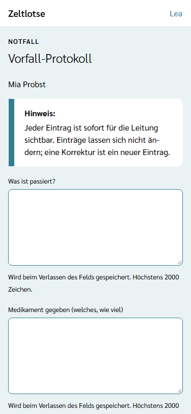
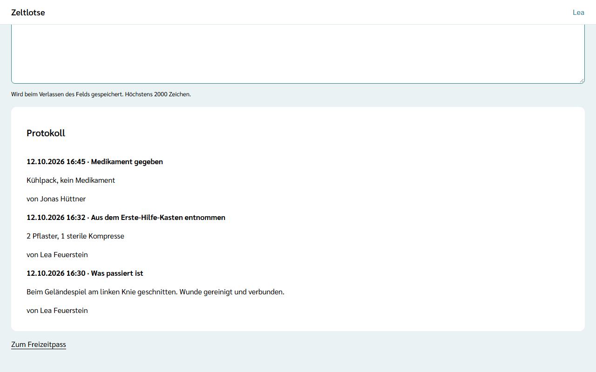

Nach einer Verletzung, einem Unwohlsein oder einem anderen Vorfall hält das **Vorfall-Protokoll** fest, was passiert ist. Es gehört zu genau einer Person der Freizeit – zu einem Kind, aber auch zu jemandem aus Leitung oder Team. Leitung und Team schreiben und lesen es; so sieht eine zweite Helferin sofort, was schon gegeben wurde.

## Der Weg zum Vorfall-Protokoll

Das Vorfall-Protokoll hängt am Freizeitpass der betroffenen Person:

1. Die Person suchen – im Notfall über das Suchfeld **Betroffene Person suchen** auf der Sicherheitskette (siehe [Notfall](/mitarbeitende/notfall/)), sonst über die Seite **Freizeitpässe**.
2. Im Freizeitpass unter „Zurück zu den Freizeitpässen“ den Link **Vorfall-Protokoll** wählen.

Die Sicherheitskette zeigt diesen Weg in der Card **Vorfall-Protokoll** vor „Wen anrufen“.

## Drei Felder, Speichern beim Verlassen

Die Seite zeigt unter der Dachzeile „Notfall“ den Namen der Person und drei Felder:

- **Was ist passiert?**
- **Medikament gegeben (welches, wie viel)**
- **Aus dem Erste-Hilfe-Kasten entnommen**

Einen Knopf zum Senden gibt es nicht. Sobald ein Feld mit neuem Text verlassen wird, speichert Zeltlotse den Text als **einen Eintrag** dieser Art. Danach ist das Feld wieder leer, darunter steht „Gespeichert“, und der Eintrag erscheint oben in der Card **Protokoll**. Klappt das Speichern nicht, bleibt der Text im Feld, und am Feld steht, was nicht geklappt hat. Ein Feld darf höchstens 2000 Zeichen haben.

## Das Protokoll

Die Card **Protokoll** zeigt alle Einträge zu der Person, den neuesten oben. Jeder Eintrag nennt Datum und Uhrzeit, die Art („Was passiert ist“, „Medikament gegeben“ oder „Aus dem Erste-Hilfe-Kasten entnommen“), den Text und wer ihn geschrieben hat. Gibt es noch keinen Eintrag, steht dort „Noch keine Einträge.“

## Keine Änderung, Korrektur als neuer Eintrag

Einträge lassen sich **nicht ändern und nicht löschen**. Wer sich vertan hat, schreibt einen neuen Eintrag mit der Korrektur. So bleibt nachvollziehbar, was wann festgehalten wurde.

## Sofort für die Leitung sichtbar

Jeder Eintrag ist sofort für die Leitung sichtbar: Sie sieht alle Einträge der Freizeit auf ihrer Startseite in der Card **Vorfall-Notizen** – siehe [Vorfall-Notizen](/leitung/vorfall-notizen/). Eine Mail oder eine Push-Nachricht gibt es dazu nicht.

## Nach dem Abschluss

Bis zum Abschluss der Freizeit lassen sich Einträge schreiben, auch in der Nachbereitung. Nach dem Abschluss fehlen die Felder, und oben steht „Diese Freizeit ist abgeschlossen und nur lesbar.“ Die Einträge gehen dann ins Archiv der Organisation. Das Abschließen einer Freizeit kommt mit einer späteren Version; bis dahin bleibt das Archiv leer.

## Entnahmen und Verlustliste

Was aus dem Erste-Hilfe-Kasten entnommen wurde, setzt Zeltlotse zusätzlich auf die Liste **Schäden & Verluste** der Freizeit, als „Erste-Hilfe-Entnahme · Erste-Hilfe-Kasten“; niemand muss es zweimal eintragen. Leitung und Team sehen dort auch den Text aus dem Vorfall-Protokoll, die Organisation nach dem Abschluss nur „Erste-Hilfe-Kasten“ – siehe [Schäden und Verluste eintragen](/mitarbeitende/schaeden-verluste/#entnahmen-aus-dem-vorfall-protokoll).

Das Vorfall-Protokoll braucht eine Verbindung; offline lässt es sich noch nicht schreiben. Der Text steht nur verschlüsselt in der Datenbank – mehr dazu unter [Was passiert mit meinen Daten](/daten/#vorfall-protokoll).
