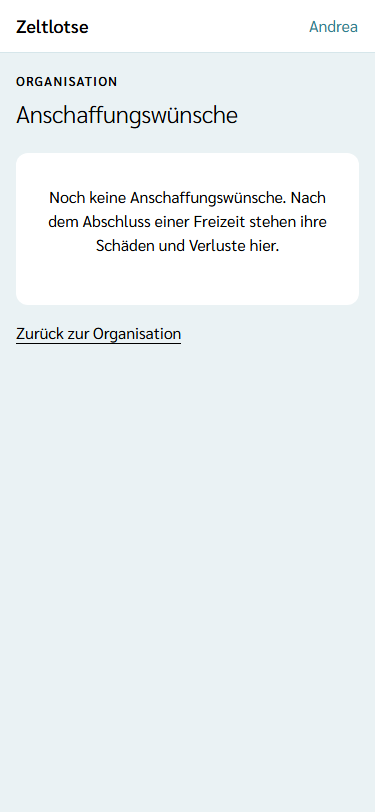
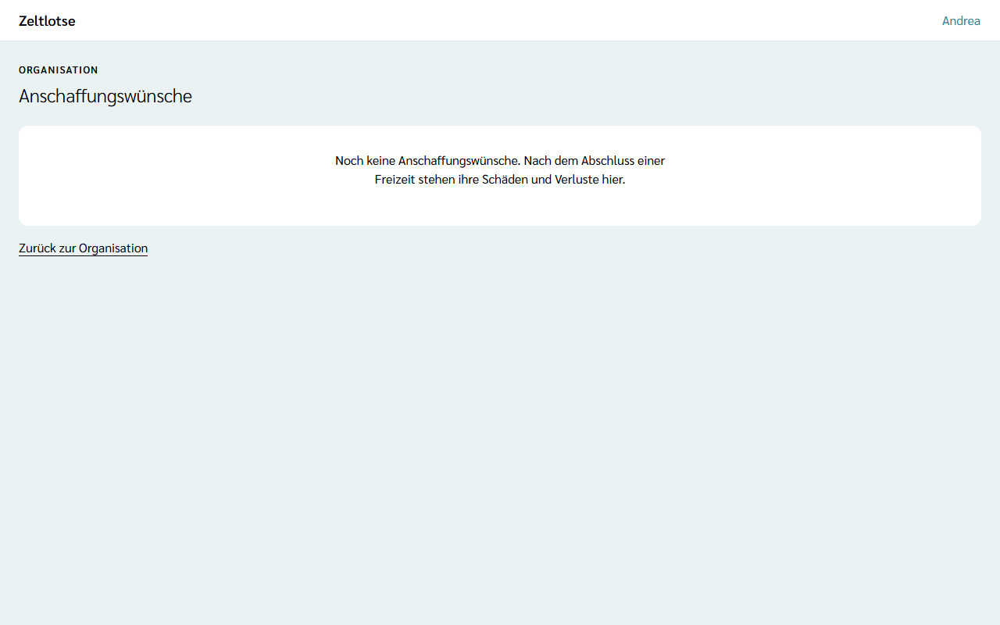

Was auf einer Freizeit kaputtgegangen, verloren gegangen oder aus dem Erste-Hilfe-Kasten verbraucht worden ist, tragen Leitung und Team auf ihrer Liste **Schäden & Verluste** ein – siehe [Schäden und Verluste eintragen](/mitarbeitende/schaeden-verluste/). Sobald die Leitung die Freizeit abschließt, sieht die Organisation diese Einträge als **Anschaffungswünsche**. Niemand muss dafür etwas abschreiben oder weiterleiten.

## Die Anschaffungswünsche öffnen

Auf der Seite der Organisation steht die Card **Anschaffungswünsche** mit dem Satz „Nach dem Abschluss einer Freizeit stehen ihre Schäden und Verluste hier, bis sie erledigt sind.“ Der Knopf **Anschaffungswünsche öffnen** führt zur Seite „Anschaffungswünsche“; über der Überschrift steht „Organisation“. Die Card sehen der **Org-Admin** und der **Org-Überblick**.

Je abgeschlossener Freizeit steht eine Card mit ihrem Namen, die Freizeit mit dem neuesten Eintrag oben. Darin steht je Eintrag eine Zeile aus Art, Text und Datum, zum Beispiel „Verlust · Taschenlampe · 04.08.2027“. Entnahmen aus dem Vorfall-Protokoll heißen „Erste-Hilfe-Entnahme · Erste-Hilfe-Kasten“; was genau entnommen wurde, bleibt im Vorfall-Protokoll der Freizeit, und die Organisation sieht weder diesen Text noch Namen.

Einträge von Freizeiten, die noch nicht abgeschlossen sind, stehen hier nicht. Gibt es noch keine, steht dort „Noch keine Anschaffungswünsche. Nach dem Abschluss einer Freizeit stehen ihre Schäden und Verluste hier.“ Das Abschließen einer Freizeit kommt mit einer späteren Version; bis dahin bleibt die Seite leer.

## Erledigt

Ist etwas ersetzt oder repariert, tippt der Org-Admin in der Zeile auf **Erledigt**. Es klappt eine Rückfrage auf („„Taschenlampe“ als erledigt entfernen?“ – „Ja, erledigt“ / „Nein“). Danach ist der Eintrag weg, auch auf der Liste der Freizeit. Einen Stand „angeschafft“ gibt es nicht: Erledigt heißt entfernt. Ist eine Freizeit ganz erledigt, verschwindet ihre Card.

Leitung und Team können nach dem Abschluss noch Einträge ergänzen; sie stehen dann sofort hier.

## Org-Überblick

Der Org-Überblick sieht dieselbe Seite mit allen Einträgen, aber ohne den Knopf **Erledigt**. Als erledigt markieren kann nur der Org-Admin.

## Wie lange die Einträge bleiben

Nicht erledigte Einträge löscht Zeltlotse automatisch mit den übrigen Daten der Freizeit, sobald die Frist für „Daten einer Freizeit“ abgelaufen ist – siehe [Löschfristen](/org-admin/loeschfristen/).
