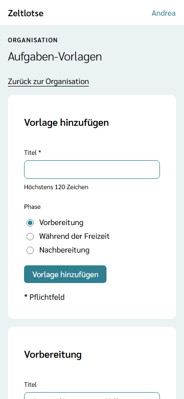
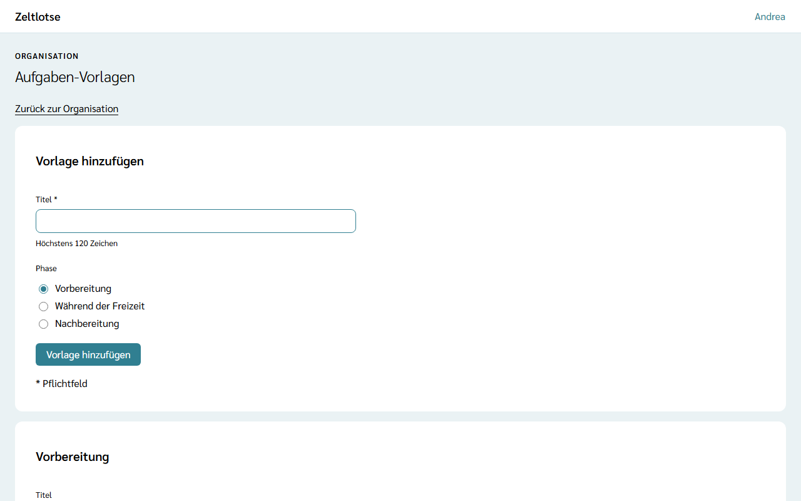

Manche Aufgaben stehen auf jeder Freizeit an: den Vertrag mit dem Zeltplatz prüfen, den Erste-Hilfe-Kasten auffüllen, den Platz am Ende besenrein übergeben. Als **Aufgaben-Vorlagen** der Organisation stehen sie in jeder neuen Freizeit schon in den Aufgaben, ohne dass jemand sie abschreibt. Wie Leitung und Team mit Aufgaben arbeiten, steht unter [Aufgaben übernehmen und abhaken](/mitarbeitende/aufgaben/).

## Die Vorlagen öffnen

Auf der Seite der Organisation steht die Card **Aufgaben-Vorlagen** mit dem Knopf **Aufgaben-Vorlagen öffnen**. Über der Überschrift „Aufgaben-Vorlagen“ steht „Organisation“. Die Card und die Seite gibt es nur für den **Org-Admin**; der Org-Überblick sieht sie nicht.

## Eine Vorlage hinzufügen

Oben steht das Formular **Vorlage hinzufügen**:

- **Titel** – Pflicht, höchstens 120 Zeichen,
- **Phase** – **Vorbereitung** (vorgewählt), **Während der Freizeit** oder **Nachbereitung**.

**Vorlage hinzufügen** speichert; die Vorlage steht danach in der Card ihrer Phase. Fehlt der Titel oder ist er zu lang, steht der Fehler direkt am Feld.

Auch Leitung und Team legen Vorlagen an: Auf der Seite einer Aufgabe speichert **Als Vorlage speichern** sie mit Titel und Phase hier ab. Was dabei doppelt oder überflüssig entsteht, räumt der Org-Admin hier auf.

## Bearbeiten und löschen

Je Phase steht eine Card mit den Vorlagen. Der Titel jeder Vorlage steht in einem Feld; Zeltlotse speichert beim Verlassen des Felds, darunter steht „Gespeichert“ mit „Rückgängig“. Hat jemand anderes den Titel inzwischen geändert, steht dort „Inzwischen geändert – neu laden?“.

**Vorlage löschen** klappt eine Rückfrage auf („„Zeltplatz-Vertrag prüfen“ löschen?“ – „Ja, löschen“ / „Nein“). Danach ist die Vorlage weg.

Gibt es noch keine Vorlagen, steht dort „Noch keine Aufgaben-Vorlagen. Neue Freizeiten übernehmen sie beim ersten Öffnen der Aufgaben.“

## Wann eine Freizeit die Vorlagen bekommt

Eine Freizeit übernimmt die Vorlagen **einmal**, wenn zum ersten Mal jemand aus Leitung oder Team ihre Aufgaben öffnet (auch über die Startseite der Freizeit). Daraus folgt:

- Eine Vorlage, die erst danach entsteht, kommt nicht mehr in diese Freizeit, nur in Freizeiten, deren Aufgaben noch niemand geöffnet hat.
- Ändert der Org-Admin eine Vorlage oder löscht er sie, bleiben die Aufgaben, die schon aus ihr entstanden sind, wie sie sind.
- Eine abgeschlossene Freizeit übernimmt keine Vorlagen mehr.

Vorlagen enthalten keine Personendaten und bleiben, bis der Org-Admin sie löscht; die Löschfristen betreffen nur die Aufgaben in den Freizeiten.
