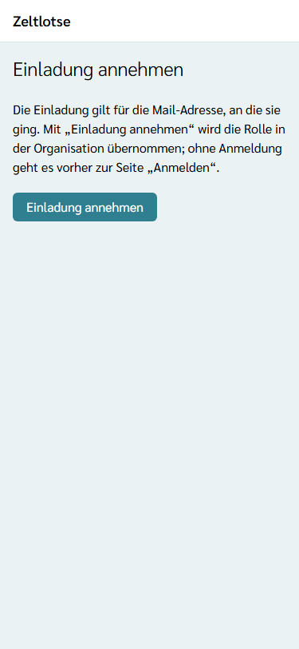
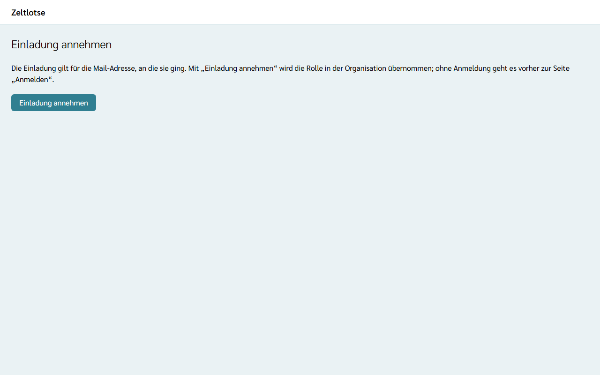

Org-Admin und Org-Überblick entstehen in Zeltlotse nur über eine **Einladung**. Den ersten Org-Admin einer Organisation lädt der [Betreiber](/betreiber/) ein, alle weiteren lädt ein Org-Admin ein (siehe [Rollen vergeben](/org-admin/rollen-vergeben/)).

## So geht es

1. In der Mail „Einladung zu Zeltlotse“ stehen der Name der Organisation, die Rolle und ein Link. Den Link öffnen.
2. Es erscheint die Seite **Einladung annehmen**. Das Öffnen allein nimmt noch nichts an.
3. **Einladung annehmen** wählen.
4. Ohne Anmeldung erscheint zuerst die Seite „Anmelden“. Mit **derselben Mail-Adresse** anmelden, an die die Einladung ging. Danach erscheint wieder die Seite „Einladung annehmen“; dort noch einmal **Einladung annehmen** wählen.
5. Zeltlotse zeigt die Seite der Organisation mit „Rolle: Org-Admin“ bzw. „Rolle: Org-Überblick“.

:::tip[Am einfachsten mit Login-Code]
Für die Anmeldung in Schritt 4 am besten den **Login-Code** aus der Login-Mail eintippen. Dann geht es direkt zurück zur Einladung. Wer stattdessen den Login-Link aus der Mail öffnet, landet in einem neuen Fenster auf der Startseite. In diesem Fall den Einladungslink aus der ersten Mail einfach noch einmal öffnen und „Einladung annehmen“ wählen.
:::

## Wenn die Einladung nicht mehr gilt

Erscheint „Fehler: Diese Einladung ist nicht mehr gültig oder gilt für eine andere Mail-Adresse.“, hat das einen dieser Gründe:

- Die Einladung ist **älter als 7 Tage**.
- Sie wurde **schon angenommen** – jede Einladung gilt nur einmal.
- Es kam eine **neuere Einladung** derselben Organisation an dieselbe Mail-Adresse mit derselben Rolle; dann gilt nur der Link aus der neuesten Mail.
- Die Anmeldung läuft mit einer **anderen Mail-Adresse** als der eingeladenen. Ein weitergeleiteter Link verschafft keine Rolle.

Im letzten Fall abmelden (Seite „Konto“) und mit der eingeladenen Mail-Adresse neu anmelden. Sonst um eine neue Einladung bitten.
