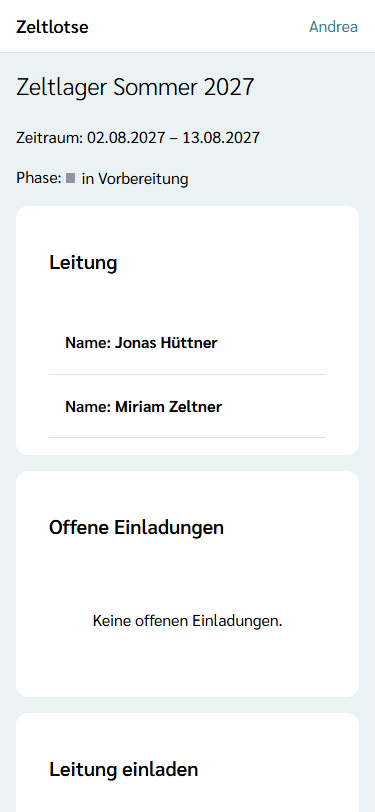
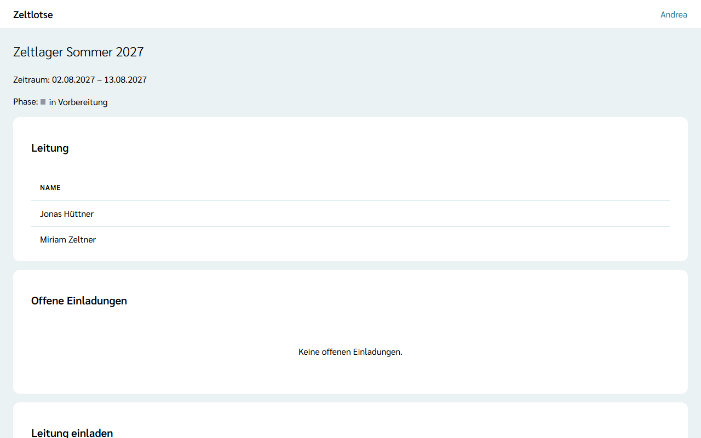

Freizeiten legt der **Org-Admin** auf der Seite der Organisation an. Danach lädt er die **Leitung** ein; die Leitung plant und führt die Freizeit, der Org-Admin sieht von ihr nur Name, Zeitraum, Phase und wer die Leitung hat.

## Freizeit anlegen

1. Auf der Startseite bei der eigenen Organisation **Organisation öffnen** wählen.
2. Unter **Freizeit anlegen** den **Namen der Freizeit** eintragen, zum Beispiel „Zeltlager Sommer 2027“.
3. **Erster Tag** und **Letzter Tag** wählen. Eine Freizeit kann auch nur einen Tag dauern; der letzte Tag darf nicht vor dem ersten liegen.
4. **Freizeit anlegen** wählen. Danach steht dort „Gespeichert: Die Freizeit ist angelegt.“, und die Freizeit erscheint in der Liste **Freizeiten**.

Die Liste zeigt jede Freizeit mit Zeitraum und **Phase** („in Vorbereitung“, „läuft“, „Nachbereitung“, „gelaufen“), die neueste zuerst. Was die Phasen bedeuten, steht unter [Freizeit öffnen](/leitung/freizeit-oeffnen/#phasen-der-freizeit). Der Org-Überblick sieht die Liste auch, kann aber keine Freizeit anlegen.

Beim Anlegen schreibt Zeltlotse auch fest, wie lange die Freizeit nach ihrem Ende noch Einsicht in die Freizeitpässe hat: das **Freigabefenster**. Heute gilt dafür die Vorgabe von 30 Tagen (siehe [Was passiert mit meinen Daten](/daten/#freigabefenster-wann-die-einsicht-endet)).

## Leitung einladen

Die Leitung setzt der Org-Admin per Einladung ein:

1. In der Liste **Freizeiten** auf den Namen der Freizeit tippen. Es erscheint die Seite der Freizeit.
2. Unter **Leitung einladen** die **Mail-Adresse** eintragen.
3. **Einladung schicken** wählen. Danach steht dort „Gespeichert: Die Einladung ist verschickt.“, und die Einladung erscheint unter **Offene Einladungen** mit „gültig bis …“.

Die Seite der Freizeit zeigt außerdem den Zeitraum, die Phase und unter **Leitung**, wer schon Leitung ist – nur mit Vor- und Nachname. Hat eine Person im Profil noch keinen Namen eingetragen, steht dort „Name fehlt“. **Zur Organisation** führt zurück.

Die eingeladene Person bekommt eine Mail „Einladung als Leitung in Zeltlotse“ mit dem Namen der Freizeit und einem Link. Wie sie annimmt, steht unter [Freizeit öffnen](/leitung/freizeit-oeffnen/). Eine Einladung gilt **7 Tage**, nur einmal und nur für die eingeladene Mail-Adresse. Eine neue Einladung an dieselbe Mail-Adresse für dieselbe Freizeit ersetzt die vorige.

Freizeiten bearbeiten oder löschen, die Leitung wieder entziehen und Einladungen zurückziehen geht in dieser Version noch nicht.
