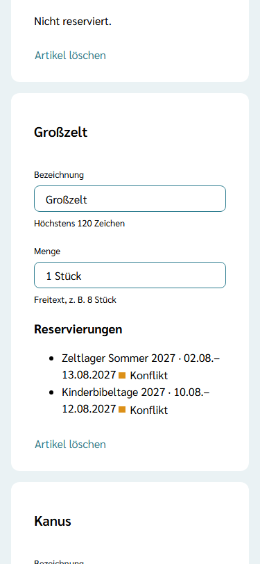
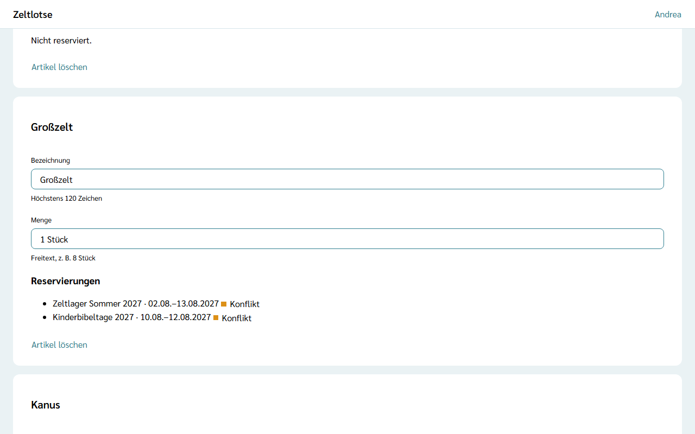

Zelte, Fahnen, Kanus oder Gaskocher gehören meist nicht einer Freizeit, sondern der Organisation. Im **Inventar** stehen sie einmal für alle Freizeiten der Organisation. Leitung und Team einer Freizeit reservieren daraus, was sie für ihren Zeitraum brauchen – wie das geht, steht unter [Material aus dem Inventar reservieren](/mitarbeitende/inventar/). Auf dieser Seite sieht die Organisation, welche Freizeit was wann reserviert hat.

## Das Inventar öffnen

Auf der Seite der Organisation steht die Card **Inventar** mit dem Satz „Material der Organisation, das Freizeiten für ihren Zeitraum reservieren.“ Der Knopf **Inventar öffnen** führt zur Seite „Inventar“. Die Card sehen der **Org-Admin** und der **Org-Überblick**.

Die Seite zeigt je Artikel eine Card, nach der Bezeichnung sortiert. Gibt es noch keinen Artikel, steht dort „Noch kein Inventar.“

## Artikel hinzufügen

Am Ende der Seite steht für den Org-Admin das Formular **Artikel hinzufügen**:

- **Bezeichnung** – Pflicht, höchstens 120 Zeichen, zum Beispiel „Großzelt“,
- **Menge** – freiwillig, höchstens 40 Zeichen, als freier Text, zum Beispiel „1 Stück“ oder „8 Stück“.

**Artikel hinzufügen** speichert den Artikel. Er erscheint ohne weitere Eingabe auch auf der Inventar-Seite jeder Freizeit der Organisation. Fehlt die Bezeichnung oder ist ein Text zu lang, steht der Fehler direkt am Feld. Zeltlotse rechnet Mengen nicht und zählt keine Stücke: Die Menge ist ein Hinweis für die Leitungen.

## Artikel ändern und löschen

In jeder Card stehen **Bezeichnung** und **Menge** in Feldern. Zeltlotse speichert beim Verlassen des Felds; darunter steht „Gespeichert“ mit „Rückgängig“. Hat jemand anderes dasselbe Feld inzwischen geändert, steht dort „Inzwischen geändert – neu laden?“. Eine leere Menge heißt: ohne Menge.

**Artikel löschen** klappt eine Rückfrage auf („„Kanus“ löschen?“ – „Ja, löschen“ / „Nein“). Hat eine Freizeit den Artikel noch reserviert, bleibt er stehen, und oben steht „Noch reserviert. Löschen geht erst, wenn keine Freizeit den Artikel mehr reserviert hat.“ So verschwindet keine Reservierung unbemerkt. Reservierungen einer vergangenen Freizeit löscht Zeltlotse automatisch, sobald die Frist für „Daten einer Freizeit“ abgelaufen ist (siehe [Löschfristen](/org-admin/loeschfristen/)); danach lässt sich der Artikel löschen. Die Artikel selbst bleiben.

## Reservierungen und Überschneidungen

Unter jedem Artikel stehen seine Reservierungen aus allen Freizeiten der Organisation, die früheste oben: der Name der Freizeit und der Zeitraum, zum Beispiel „Zeltlager Sommer 2027 · 02.08.–13.08.2027“. Ohne Reservierung steht dort „Nicht reserviert.“

Haben zwei Freizeiten denselben Artikel für Tage reserviert, die sich überschneiden, steht bei beiden Reservierungen der Status **Konflikt**. Schon ein gemeinsamer Tag zählt: Endet die eine Reservierung am 13.08. und beginnt die andere am 13.08., ist das ein Konflikt. Zeltlotse verhindert keine Reservierung und entscheidet nichts: Die Leitungen der Freizeiten sprechen sich ab, außerhalb von Zeltlotse.

## Org-Überblick

Der Org-Überblick sieht dieselbe Seite mit allen Artikeln, Mengen und Reservierungen, aber ohne Felder, ohne das Formular **Artikel hinzufügen** und ohne **Artikel löschen**. Pflegen kann das Inventar nur der Org-Admin. Reservieren und Reservierungen aufheben geht nur in einer Freizeit, für Leitung und Team.

## Noch nicht dabei

Schäden, Verluste und Anschaffungswünsche kommen mit einer späteren Version. Den Inhalt einer Kiste einzeln zu erfassen oder die Rückgabe nach der Freizeit abzuhaken, ist nicht geplant.
