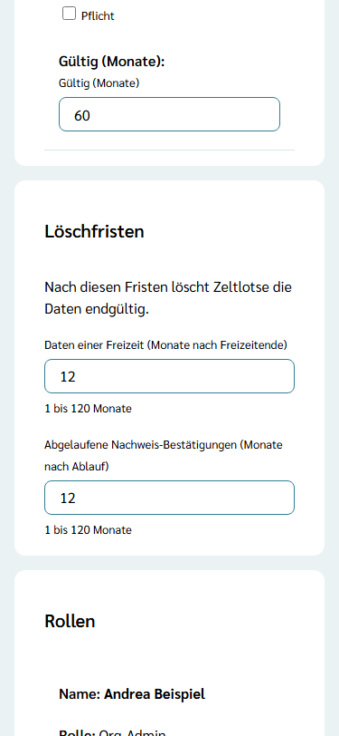
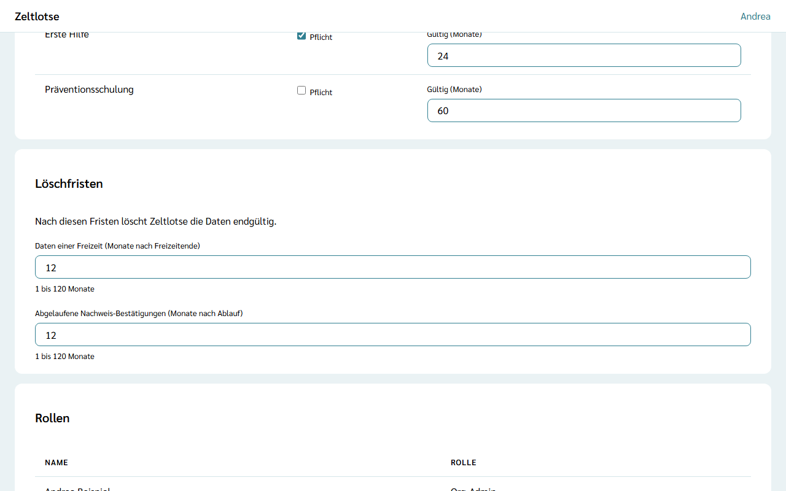

Die **Löschfristen** legen fest, wie lange Zeltlotse Daten aufbewahrt, die die Organisation eine Zeit lang braucht. Danach löscht Zeltlotse sie automatisch und endgültig, einmal am Tag. Die Löschfristen stehen auf der Seite der Organisation in der Card „Löschfristen“ unter der Richtlinie für Nachweise; nur der Org-Admin sieht und ändert sie.

## Die zwei Fristen

- **Daten einer Freizeit (Monate nach Freizeitende):** Arbeitsdaten einer Freizeit werden so viele Monate nach dem Ende des letzten Freizeittages gelöscht. Heute sind das die Erinnerungen an fehlende Nachweise; weitere Daten der Freizeit folgen. Die Freizeit selbst und die Rollen von Leitung und Team bleiben.
- **Abgelaufene Nachweis-Bestätigungen (Monate nach Ablauf):** Eine Bestätigung eines Nachweises wird so viele Monate nach ihrem „gültig bis“ gelöscht. Beispiel: Ein Führungszeugnis ist bestätigt bis 31.03.2027, die Frist ist 12 Monate – die Bestätigung wird am 31.03.2028 gelöscht.

Jede neue Organisation beginnt mit **12 Monaten** für beide Fristen. Erlaubt sind 1 bis 120 Monate.

## Fristen ändern

1. Auf der Seite der Organisation zur Card **Löschfristen** gehen.
2. Im Feld die Zahl der Monate eintragen, zwischen 1 und 120. Das speichert beim Verlassen des Feldes.

Danach steht am Feld „Gespeichert“ mit „Rückgängig“. Hat ein anderer Org-Admin dasselbe Feld gleichzeitig geändert, steht dort „Inzwischen geändert – neu laden?“. Eine kürzere Frist wirkt beim nächsten täglichen Lauf, auch für schon vorhandene Daten.

## Feste Fristen

Einige Fristen legt Zeltlotse fest, weil es sich um Zugangslinks ohne fachlichen Wert handelt:

- **Login-Links und Login-Codes:** einen Tag nach ihrem Ablauf gelöscht.
- **Einladungen und Profil-Übergaben:** 30 Tage nach ihrem Ablauf gelöscht.
- **Sicherheitsprotokoll:** nach 365 Tagen gelöscht.

Persönliche Daten wie Profil und Nachweise haben keine Frist: Sie gehören der Person und bleiben, bis sie ihr Konto löscht (siehe [Zugriffsprotokoll und Meine Daten](/erste-schritte/meine-daten/)). Mehr dazu steht unter [Was passiert mit meinen Daten](/daten/).
