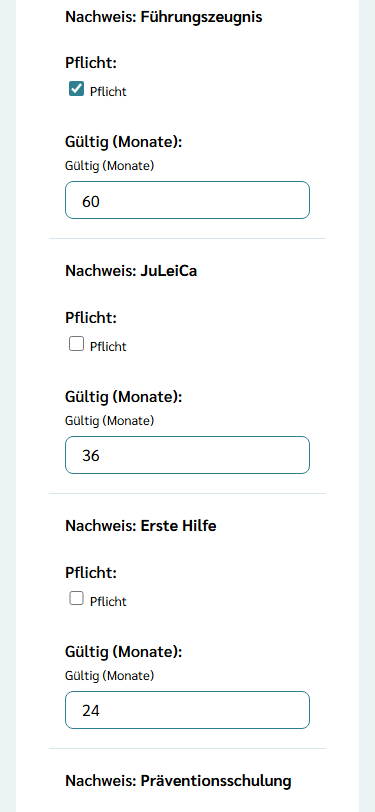
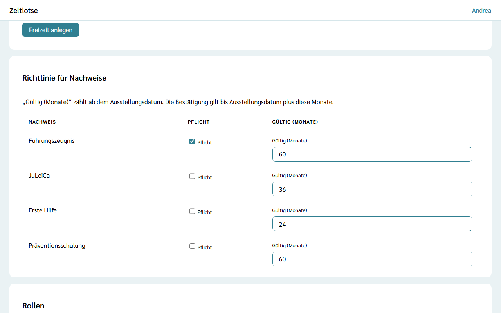

Die **Richtlinie für Nachweise** legt je Nachweisart fest, ob sie **Pflicht** ist und wie viele Monate eine Bestätigung **gültig** ist. Sie steht auf der Seite der Organisation in der Card „Richtlinie für Nachweise“; nur der Org-Admin sieht und ändert sie.

**Pflicht** legt fest, welche Nachweise die Organisation von ihren Mitarbeitenden verlangt. **Gültig (Monate)** bestimmt, wie lange eine Bestätigung ab dem Ausstellungsdatum gilt.

## Pflicht und Gültigkeit ändern

1. Auf der Seite der Organisation zur Card **Richtlinie für Nachweise** gehen.
2. In der Zeile der Nachweisart **Pflicht** ankreuzen oder das Kreuz entfernen. Das speichert sofort.
3. Im Feld **Gültig (Monate)** die Zahl der Monate eintragen, zwischen 1 und 120. Das speichert beim Verlassen des Feldes.

Danach steht am Feld „Gespeichert“ mit „Rückgängig“. Hat ein anderer Org-Admin dasselbe Feld gleichzeitig geändert, steht dort „Inzwischen geändert – neu laden?“.

## Vorgabewerte

Jede neue Organisation beginnt mit diesen Werten:

| Nachweis | Pflicht | Gültig |
| --- | --- | --- |
| Führungszeugnis | ja | 60 Monate (5 Jahre) |
| JuLeiCa | nein | 36 Monate (3 Jahre) |
| Erste Hilfe | nein | 24 Monate (2 Jahre) |
| Präventionsschulung | nein | 60 Monate (5 Jahre) |

## Wie „gültig bis“ entsteht

„Gültig bis“ wird nie von Hand eingetragen. Zeltlotse rechnet es bei der Bestätigung aus: **Ausstellungsdatum + Gültigkeit in Monaten**. Beispiel: Erste Hilfe, ausgestellt am 15.04.2025, Gültigkeit 24 Monate – gültig bis 15.04.2027.

Gerechnet wird mit der Richtlinie zum Zeitpunkt der Bestätigung. Eine spätere Änderung wirkt ab der nächsten Bestätigung; schon gespeicherte Bestätigungen bleiben, wie sie sind. Das Ausstellungsdatum selbst speichert die Organisation nicht.

## Prüfen auf Ebene der Organisation

Mit dem Knopf **Nachweise prüfen** auf der Seite der Organisation sieht der Org-Admin alle Personen, die in einer Freizeit der Organisation mitarbeiten, außer der eigenen Person. Dort lässt sich mit **Einsicht anfragen** um Einsicht bitten; der Org-Admin ist dann die prüfende Person. Auch eine Anfrage, die mit der ersten Mitarbeit von selbst entstanden ist, kann der Org-Admin mit **Prüfen** übernehmen, solange noch niemand anderes prüft. So lässt sich auch die einzige Leitung einer Freizeit prüfen. Geprüft wird wie bei der Leitung, siehe [Nachweise prüfen](/leitung/nachweise-pruefen/).

:::caution[Heruntergeladene Datei löschen]
Ein PDF lädt der Browser beim Öffnen herunter, und auch ein Foto lässt sich auf dem Gerät speichern. Jede Datei, die auf dem Gerät gespeichert wurde (Foto oder PDF), nach der Prüfung löschen; bei der Organisation bleibt nur die Bestätigung.
:::
