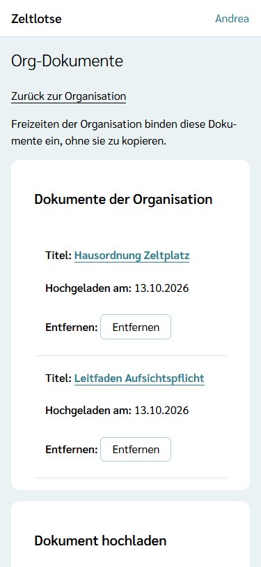
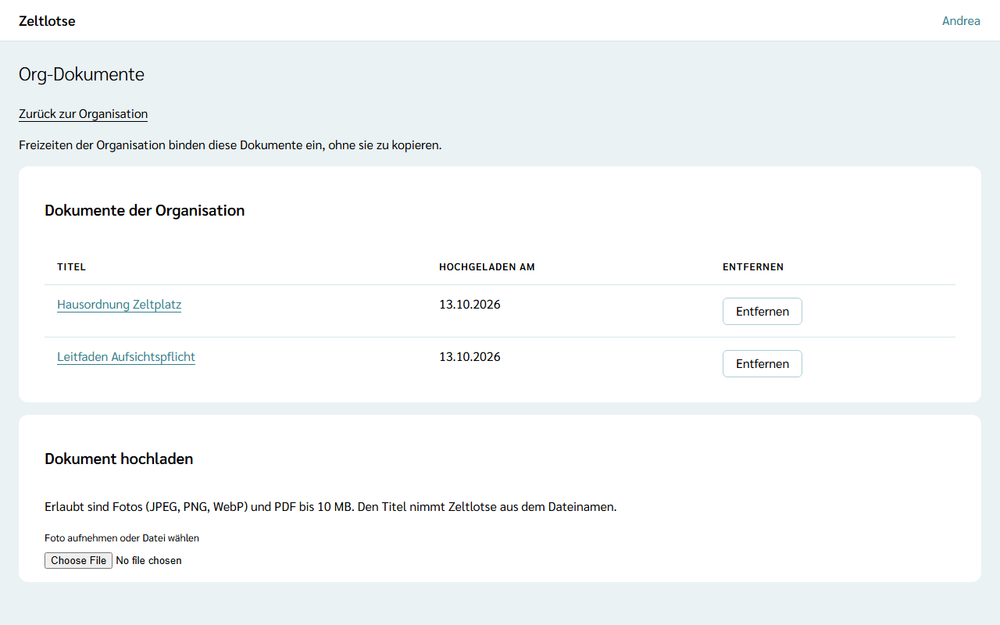

**Org-Dokumente** sind Dateien, die für viele Freizeiten der Organisation gelten, zum Beispiel die Hausordnung eines Zeltplatzes oder ein Leitfaden zur Aufsichtspflicht. Der Org-Admin legt sie einmal ab; jede Freizeit der Organisation kann sie einbinden.

## Einbinden statt kopieren

Eine Freizeit **bindet** ein Org-Dokument **ein**, sie kopiert es nicht. Titel und Datei liegen nur bei der Organisation; die Freizeit merkt sich nur einen Verweis darauf:

- **Entfernen wirkt in allen Freizeiten**: Ein entferntes Org-Dokument verschwindet aus der Liste jeder Freizeit, aus der Elterninfo und von der Freizeitseite.
- Wer es in einer Freizeit sieht, legt die Freizeit selbst fest (Sichtbarkeit „Team“, „Eltern und Teilnehmende“ oder „Öffentlich“); beim Einbinden ist es zuerst nur für das Team sichtbar.

Wie Leitung und Team Org-Dokumente einbinden, steht unter [Dokumente ablegen](/mitarbeitende/dokumente/#aus-der-organisation-einbinden).

## Die Seite „Org-Dokumente“

Auf der Seite der Organisation steht für den Org-Admin die Card **Org-Dokumente** mit dem Knopf **Org-Dokumente öffnen**. Die Seite zeigt die Org-Dokumente als Tabelle, sortiert nach Titel:

- den **Titel** als Link: Ein Tipp lädt die Datei herunter,
- **Hochgeladen am**,
- den Knopf **Entfernen**.

## Hochladen

In der Card **Dokument hochladen** eine Datei wählen; die Wahl lädt sofort hoch. Erlaubt sind Fotos (JPEG, PNG, WebP) und PDF bis 10 MB. Den Titel nimmt Zeltlotse aus dem Dateinamen ohne Endung. Eine Sichtbarkeit gibt es hier nicht; die wählt jede Freizeit selbst. Bricht die Verbindung ab, steht „Fehler: Datei nicht hochgeladen.“ mit **Erneut versuchen**.

## Entfernen

**Entfernen** fragt an Ort und Stelle „Org-Dokument Hausordnung Zeltplatz entfernen? Es verschwindet auch aus allen Freizeiten.“ Erst **Ja, entfernen** löscht das Dokument samt Datei.

Org-Dokumente sehen und verwalten nur Org-Admins. Personendaten gehören nicht in Org-Dokumente.
