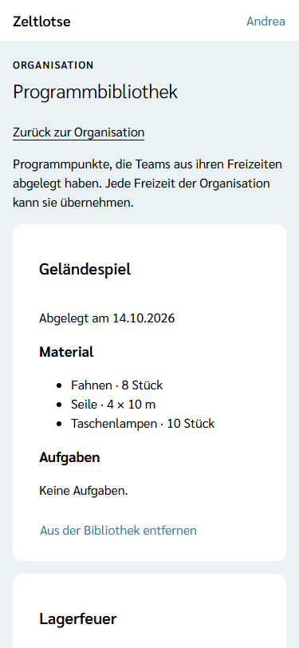
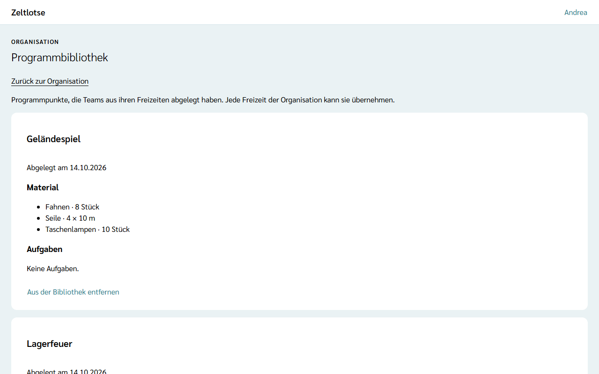

In der **Programmbibliothek** liegen gelungene Programmpunkte, die Teams aus ihren Freizeiten bewusst abgelegt haben, mit Material und Aufgaben. Jede Freizeit der Organisation kann sie übernehmen. Wie Leitung und Team ablegen und übernehmen, steht unter [Programmpunkte ablegen und übernehmen](/mitarbeitende/programmbibliothek/).

## Die Bibliothek öffnen

Auf der Seite der Organisation steht die Card **Programmbibliothek** mit dem Knopf **Programmbibliothek öffnen**. Über der Überschrift „Programmbibliothek“ steht „Organisation“. Die Card und die Seite gibt es nur für den **Org-Admin**; der Org-Überblick sieht sie nicht.

Jeder Eintrag ist eine Card mit Titel, „Abgelegt am …“, dem Material (Bezeichnung und Menge) und den Aufgaben (Titel und Phase). Gibt es denselben Titel mehrfach, steht die neueste Fassung zuerst.

Gibt es noch keine Einträge, steht dort „Noch nichts in der Programmbibliothek. Das Team legt gelungene Programmpunkte in seiner Freizeit ab.“

## Einträge entfernen

Einträge lassen sich nicht bearbeiten. Doppelte oder überholte Fassungen räumt der Org-Admin auf: **Aus der Bibliothek entfernen** klappt eine Rückfrage auf („„Geländespiel“ aus der Bibliothek entfernen?“ – „Ja, entfernen“ / „Nein“). Danach ist der Eintrag weg.

Programmpunkte in den Freizeiten bleiben davon unberührt, auch der, aus dem der Eintrag stammt. Solange seine Freizeit nicht abgeschlossen ist, steht an ihm danach wieder **In Bibliothek ablegen**, und das Team kann ihn erneut ablegen. Ist die Freizeit abgeschlossen oder ihr Programm nach der Löschfrist schon gelöscht, ist das Entfernen endgültig.

## Daten

Ein Eintrag speichert nicht, wer übernommen hat oder mitbringt; Stand und Erledigt kommen beim Ablegen ebenfalls nicht mit. Titel und Bezeichnungen sind aber Freitext; Namen gehören dort nicht hinein, weil der Eintrag die Löschfrist der Freizeit überdauert. Die Einträge gehören der Organisation und bleiben, bis der Org-Admin sie entfernt; die Löschfristen für Freizeit-Daten betreffen sie nicht.
