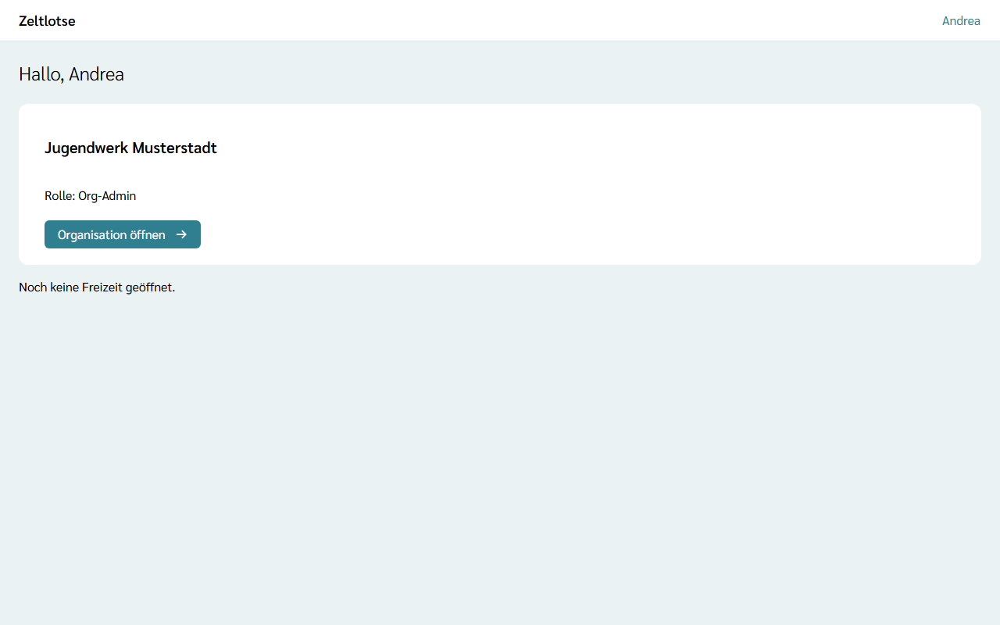
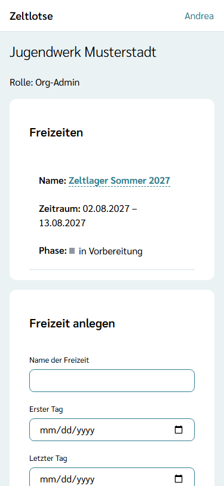
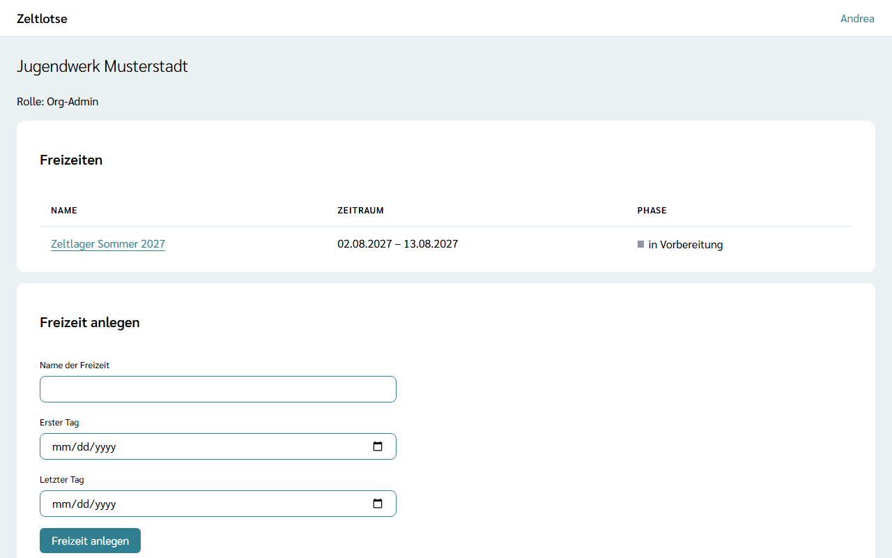

## Startseite und Seite der Organisation

Nach dem Anmelden zeigt die Startseite für jede eigene Organisation eine Card mit Name und Rolle. **Organisation öffnen** führt zur Seite der Organisation.

Oben stehen der Name der Organisation und die eigene Rolle, darunter die **Freizeiten** der Organisation und das Formular **Freizeit anlegen** (siehe [Freizeit anlegen](/org-admin/freizeit-anlegen/)). Für die Rollen sieht der Org-Admin danach drei Bereiche:

- **Rollen:** wer in der Organisation welche Rolle hat, mit Vor- und Nachname. Hat eine Person im Profil noch keinen Namen eingetragen, steht dort „Name fehlt“.
- **Offene Einladungen:** Mail-Adresse, Rolle und bis wann die Einladung gilt („gültig bis …“). Angenommene und abgelaufene Einladungen stehen hier nicht mehr.
- **Person einladen:** das Formular für neue Einladungen.

Der **Org-Überblick** sieht auf dieser Seite nur den Namen der Organisation, seine Rolle und die Liste der Freizeiten.

## Person einladen

Weitere Org-Admins und den Org-Überblick ernennt der Org-Admin per Einladung:

1. Unter **Person einladen** die **Mail-Adresse** eintragen.
2. Bei **Rolle** „Org-Admin“ oder „Org-Überblick“ wählen.
3. **Einladung schicken** wählen. Danach steht dort „Gespeichert: Die Einladung ist verschickt.“, und die Einladung erscheint unter „Offene Einladungen“.

Die eingeladene Person nimmt die Einladung an, wie unter [Einladung annehmen](/org-admin/einladung-annehmen/) beschrieben. Eine Einladung gilt **7 Tage** und nur für die eingeladene Mail-Adresse. Eine neue Einladung an dieselbe Mail-Adresse mit derselben Rolle ersetzt die vorige; nur der neueste Link gilt. Eine Person kann beide Rollen haben.

Rollen entziehen, Einladungen zurückziehen und die Organisation umbenennen geht in dieser Version noch nicht.
