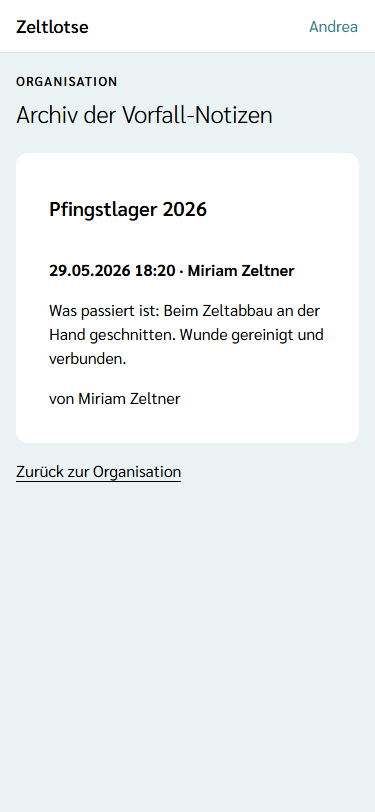
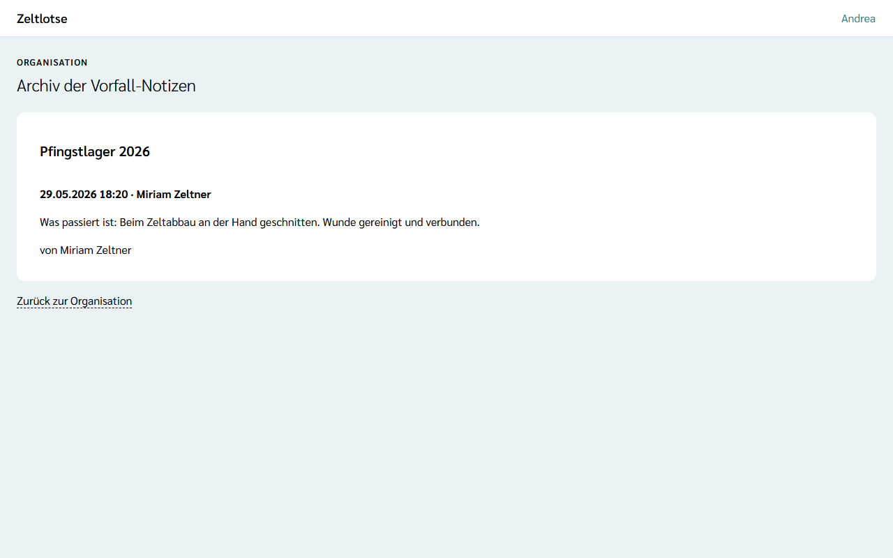

Während einer Freizeit halten Leitung und Team im [Vorfall-Protokoll](/mitarbeitende/vorfall-protokoll/) fest, was bei einem Vorfall passiert ist, welches Medikament gegeben und was aus dem Erste-Hilfe-Kasten entnommen wurde; die Leitung sieht das als [Vorfall-Notizen](/leitung/vorfall-notizen/). Nach dem Abschluss der Freizeit gehören diese Notizen der Organisation: Sie liegen im **Archiv der Vorfall-Notizen**, damit sich später nachweisen lässt, dass und wann etwas war.

## Das Archiv öffnen

Auf der Seite der Organisation steht für den Org-Admin die Card **Vorfall-Notizen** mit dem Satz „Nach dem Abschluss einer Freizeit liegen ihre Vorfall-Notizen hier, bis die Frist für Freizeit-Daten abläuft.“ Der Knopf **Archiv öffnen** führt zur Seite „Archiv der Vorfall-Notizen“.

Die Seite zeigt je abgeschlossener Freizeit eine Card mit ihrem Namen und den Einträgen, den neuesten oben: Datum, Uhrzeit und betroffene Person, die Art mit dem Text und wer den Eintrag geschrieben hat. Solange keine Freizeit mit Vorfall-Notizen abgeschlossen ist, steht dort „Noch keine archivierten Vorfall-Notizen.“ Wie die Leitung eine Freizeit abschließt, steht unter [Freizeit abschließen](/leitung/freizeit-abschliessen/).

Das Archiv sehen nur Org-Admins, nicht der Org-Überblick. Laufende Freizeiten erscheinen hier nicht; ihre Notizen sieht nur die Leitung der Freizeit.

## Frist und Löschen

- **Frist für Freizeit-Daten:** Die archivierten Notizen bleiben, bis die Frist für die Daten einer Freizeit abläuft (Vorgabe 12 Monate nach Freizeitende). Danach löscht Zeltlotse sie beim täglichen Lauf endgültig. Die Frist legt der Org-Admin unter [Löschfristen](/org-admin/loeschfristen/) fest; eine eigene Frist nur für Vorfall-Notizen gibt es nicht.
- **Wenn eine Person ihr Konto löscht:** Der Eintrag bleibt stehen, aber ohne Namen („Gelöschte Person“). Der Text war mit dem Schlüssel der betroffenen Person verschlüsselt und ist danach nicht mehr lesbar („Inhalt nicht mehr lesbar.“). So bleibt nachweisbar, dass und wann etwas war, ohne Gesundheitsdaten einer gelöschten Person.
- Einzelne Einträge lassen sich nicht ändern oder löschen, auch nicht im Archiv.
